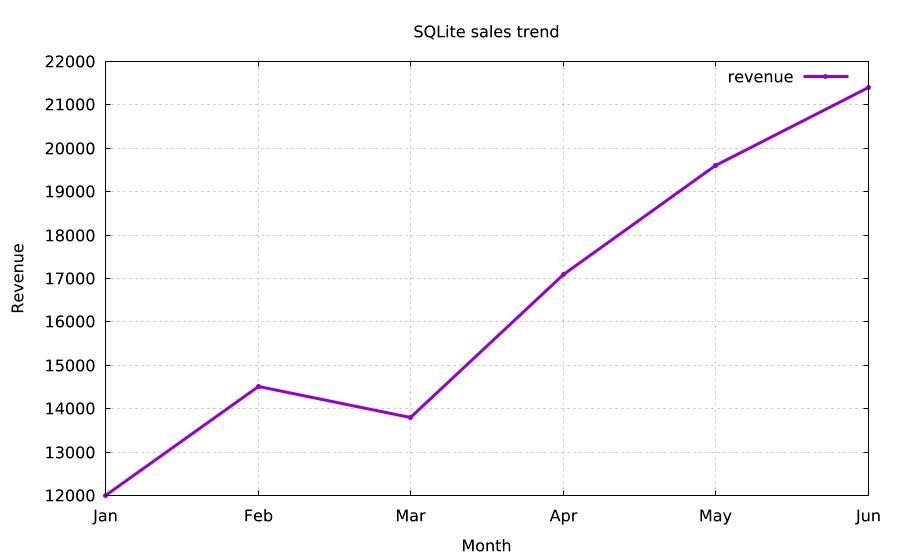
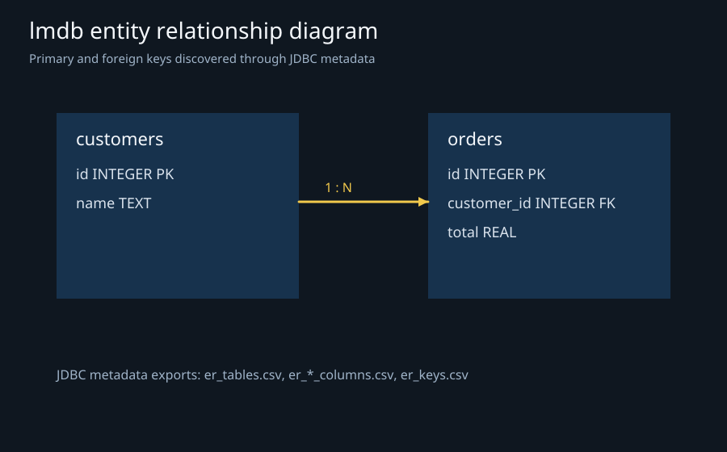
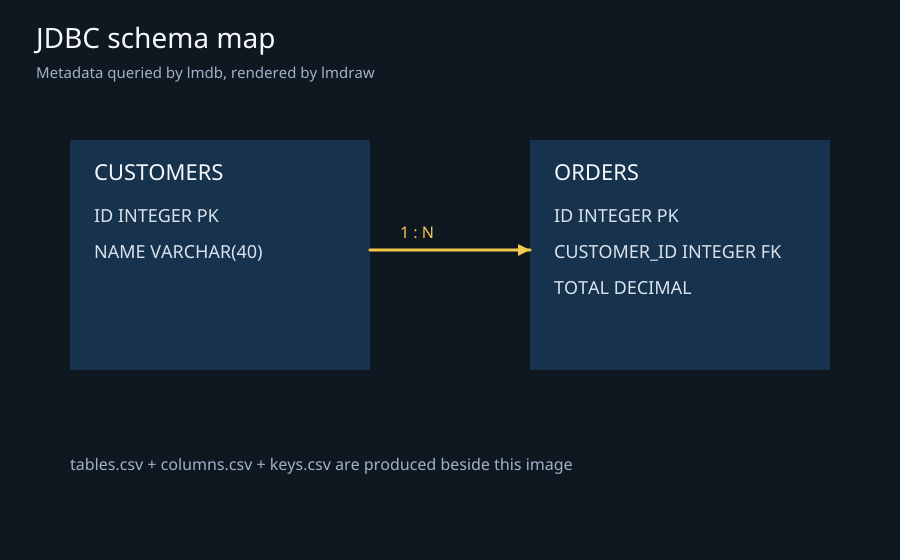

# lmdb

**A scriptable JDBC database client for queries, exports, schema inspection and visual results.**

| Query chart | ER diagram | Schema map |
| --- | --- | --- |
|  |  |  |
| Monthly revenue grouped by SQL, then plotted with lmplot<br>`lmctl https://raw.githubusercontent.com/lmctl-ai/lmdb/main/examples/sqlite_sales_trend.lms` | Primary and foreign keys discovered through JDBC metadata<br>`lmctl https://raw.githubusercontent.com/lmctl-ai/lmdb/main/examples/er_diagram.lms` | Tables and columns queried from JDBC metadata<br>`lmctl https://raw.githubusercontent.com/lmctl-ai/lmdb/main/examples/schema_map.lms` |

## Quick start

Install the release for your platform, then run a complete example from any empty directory:

```sh
lmctl https://raw.githubusercontent.com/lmctl-ai/lmdb/main/examples/sqlite_sales_trend.lms
```

The example creates an in-memory SQLite database, writes `data/sqlite_sales_trend.csv`, and renders `images/sqlite_sales_trend.png`. The database credentials never enter the output or logs. Linux release binaries require dynamic glibc >= 2.35.

## Examples

Every example is self-contained and binds lmdb plus lmplot by release. Each command writes a CSV result and a PNG chart.

| Example | Story | Run |
| --- | --- | --- |
| `sqlite_sales_trend.lms` | Monthly revenue trend | `lmctl https://raw.githubusercontent.com/lmctl-ai/lmdb/main/examples/sqlite_sales_trend.lms` |
| `sqlite_inventory.lms` | Warehouse inventory value | `lmctl https://raw.githubusercontent.com/lmctl-ai/lmdb/main/examples/sqlite_inventory.lms` |
| `sqlite_air_quality.lms` | Rolling PM2.5 average | `lmctl https://raw.githubusercontent.com/lmctl-ai/lmdb/main/examples/sqlite_air_quality.lms` |
| `sqlite_flights.lms` | Joined route delay ranking | `lmctl https://raw.githubusercontent.com/lmctl-ai/lmdb/main/examples/sqlite_flights.lms` |
| `h2_budget.lms` | Planned versus actual spend | `lmctl https://raw.githubusercontent.com/lmctl-ai/lmdb/main/examples/h2_budget.lms` |
| `h2_latency.lms` | API latency envelope | `lmctl https://raw.githubusercontent.com/lmctl-ai/lmdb/main/examples/h2_latency.lms` |
| `h2_orders.lms` | Order funnel conversion | `lmctl https://raw.githubusercontent.com/lmctl-ai/lmdb/main/examples/h2_orders.lms` |
| `h2_cohort.lms` | Cohort retention matrix | `lmctl https://raw.githubusercontent.com/lmctl-ai/lmdb/main/examples/h2_cohort.lms` |
| `duckdb_weather.lms` | Seasonal station temperatures | `lmctl https://raw.githubusercontent.com/lmctl-ai/lmdb/main/examples/duckdb_weather.lms` |
| `duckdb_energy.lms` | Cumulative energy budget | `lmctl https://raw.githubusercontent.com/lmctl-ai/lmdb/main/examples/duckdb_energy.lms` |
| `duckdb_returns.lms` | Rolling market returns | `lmctl https://raw.githubusercontent.com/lmctl-ai/lmdb/main/examples/duckdb_returns.lms` |
| `duckdb_population.lms` | Regional population density | `lmctl https://raw.githubusercontent.com/lmctl-ai/lmdb/main/examples/duckdb_population.lms` |
| `schema_map.lms` | JDBC tables, columns and primary keys | `lmctl https://raw.githubusercontent.com/lmctl-ai/lmdb/main/examples/schema_map.lms` |
| `er_diagram.lms` | JDBC primary and foreign key relationship | `lmctl https://raw.githubusercontent.com/lmctl-ai/lmdb/main/examples/er_diagram.lms` |

## JDBC host API

Inside an lmscript program, bind the host with `_dsl_ cli="lmdb" install="github:lmctl-ai/lmdb@latest"`. `connect(url)` returns a connection; `exec(sql)` runs DDL or DML; `query(sql)` returns a result. Results expose `csv(path)`, `json(path)`, `rows()`, `number(row, column)` and `text(row, column)`. `tables()`, `columns(table)`, `keys(table)` and `indexes(table)` expose JDBC metadata for schema reports. Use environment variables or a protected credentials file for server credentials.

## Drivers

The native distribution bundles PostgreSQL, SQLite-JDBC, H2, DuckDB and Microsoft SQL Server JDBC drivers. MySQL and MariaDB drivers are not bundled; on the JVM, pass a user supplied driver jar through the CLI build workflow. The release includes driver notices and the GraalVM runtime notice.

Optional drivers are a JVM feature because native-image executables cannot load arbitrary classes after compilation:

```sh
java -jar target/lmdb-0.1.1-all.jar --driver-jar /path/to/driver.jar --driver-class com.example.Driver \
  --url jdbc:example:... --sql 'SELECT 1'
```

`LMDB_MAX_MEMORY_MB` sets the allocation budget (default 4096 MiB; minimum 16 MiB). The Java heap uses at most 75%; each SQLite/DuckDB engine has a one-eighth memory-manager limit. Scripts may keep two native-engine connections and 64 total connections open; closing a connection releases its slot. Stacks, code mappings and native allocations outside the engines' memory managers are additional overhead. The host restarts itself with a startup heap cap when needed. Invalid or non-positive values fail with usage status 2; a runtime budget breach fails with status 3. Results default to 10,000 rows; `--max-rows` accepts up to 1,000,000 and exceeding the limit fails explicitly.

For the JVM distribution on Windows, put non-ASCII SQL in a UTF-8 file and use `--file`; the upstream Java launcher may convert command-line characters through the Windows ANSI code page. Native Windows releases embed a UTF-8 application manifest.

## CLI workflows

```sh
# Explain a query and inspect a schema
lmdb --url jdbc:sqlite:app.db --explain 'SELECT * FROM orders WHERE total > 100'
lmdb --url jdbc:sqlite:app.db --metadata tables --format json
lmdb --url jdbc:sqlite:app.db --metadata columns --table orders --format table

# Export a query, run a SQL file, and compare two schemas
lmdb --url jdbc:sqlite:app.db --sql 'SELECT * FROM orders' --format csv --output orders.csv
lmdb --url jdbc:sqlite:app.db --file migration.sql --format json --output result.json
lmdb --url jdbc:sqlite:app.db --diff-url jdbc:sqlite:reference.db --format json

# Keep credentials in a UTF-8 properties file; lmdb never prints them
lmdb --url jdbc:postgresql://db.example/app \
  --credentials-file credentials.properties --sql 'SELECT 1'
```

## Build

The JVM build requires JDK 21 or newer, Maven, and Python 3. `mvn -q verify` resolves the pinned lmcode-java SDK from `sdk.lock` and runs the JDBC core suites; `test.sh` adds CLI and gallery checks. CI also runs the DSL fixtures and every example with compiler `0.2.369`. Native images require GraalVM for JDK 25 with `native-image`, plus the platform C toolchain; the native profile builds the pinned JDBC JNI archives.

```sh
mvn -q verify
scripts/build-native.sh
```

Native release names are `lmdb-<os>-<arch>` with one executable per platform. The test suite exercises every bundled driver, schema metadata, CSV/JSON export, credential redaction and the five native platform binaries.

Native builds embed only the target's SQLite and DuckDB libraries. Linux links those engines statically; macOS retains DuckDB's universal library and the matching SQLite architecture; Windows retains the x64 libraries. CI inspects GraalVM's embedded-resource inventory as well as running all five drivers and all 14 examples.
